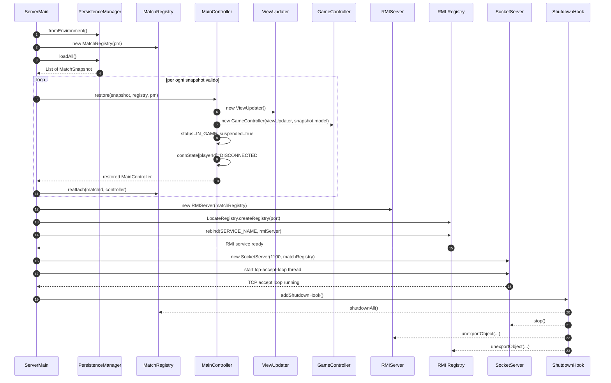

# 01 - Avvio server

Questo diagramma mostra cosa succede all'avvio: caricamento degli snapshot,
riattacco delle partite ripristinate e pubblicazione dei due trasporti.

## Classi principali

| Responsabilita | Classe |
|---|---|
| Entry point server | `ServerMain` |
| Caricamento/salvataggio snapshot | `PersistenceManager` |
| Registro globale partite | `MatchRegistry` |
| Controller di una singola partita | `MainController` |
| Trasporto RMI | `RMIServer`, `RMI Registry` |
| Trasporto TCP | `SocketServer` |
