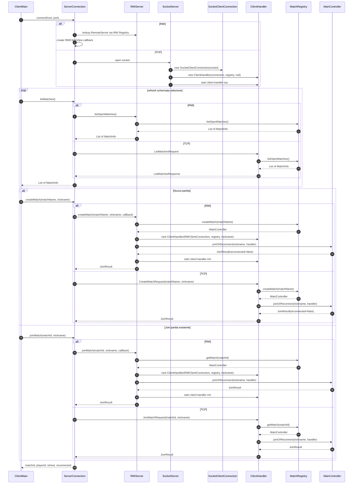

# 02 - Selezione partita

Il client si connette, ottiene la lista delle lobby aperte e poi crea o entra in
una partita. Il ramo RMI usa metodi remoti; il ramo TCP usa comandi
`Serializable` letti dal `ClientHandler` in fase pre-match.

## Punti da ricordare

- `MatchRegistry` conosce quali partite esistono.
- `MainController` gestisce una sola partita.
- Dopo `JoinResult`, il `ClientHandler` e' agganciato al `MainController` della
  partita scelta.
- `listOpenMatches()` ritorna solo match in stato `LOBBY`.
