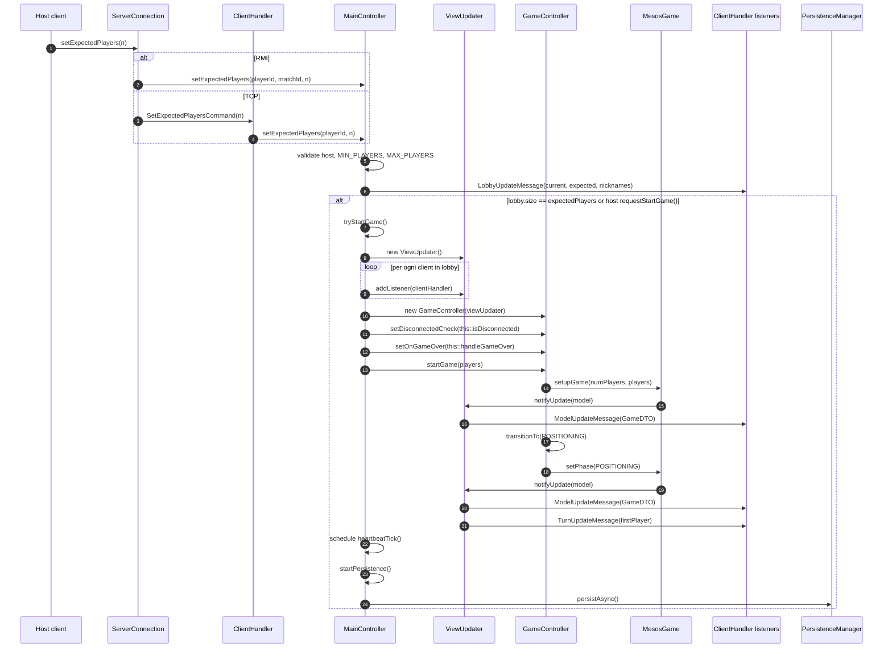

# 03 - Lobby e start partita

Il flusso di lobby e' request/response solo per i comandi host. Gli aggiornamenti
di lobby e di partita sono push event-driven verso tutti i client.

## Messaggi prodotti

| Evento | Messaggio |
|---|---|
| Cambio lobby | `LobbyUpdateMessage` |
| Setup model / cambio fase | `ModelUpdateMessage` |
| Primo turno | `TurnUpdateMessage` |

`PhaseUpdateMessage` esiste nel package messaggi, ma il flusso implementato usa
soprattutto snapshot completi via `ModelUpdateMessage`.
