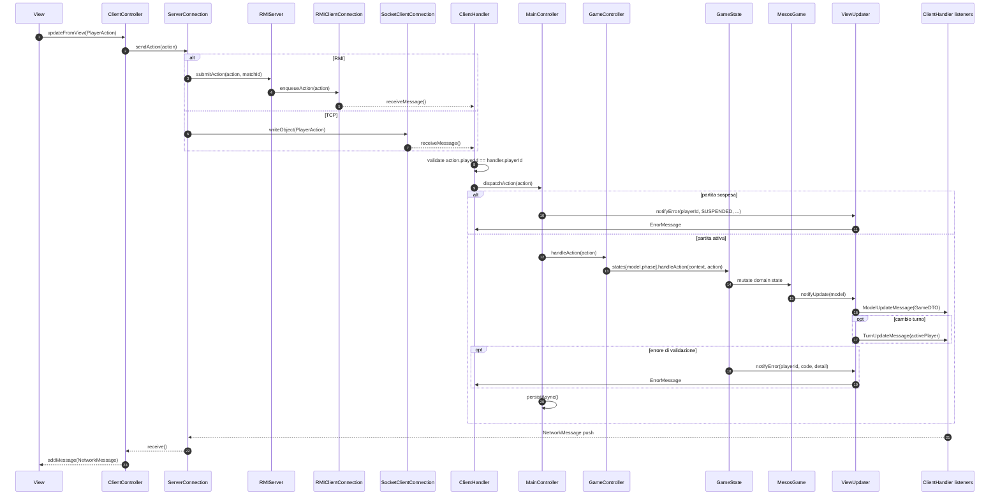

# 04 - Azione di gioco event-driven

Durante la partita il client non riceve una risposta sincrona alla propria
azione. La view invia una `PlayerAction`; il server aggiorna il model e poi
manda push event-driven a tutti i listener della partita.

## Confine MVC

- La view invia solo azioni semantiche (`PlayerAction`).
- Il model non conosce la view.
- Il server non ritorna il risultato dell'azione come response sincrona.
- Lo stato visibile alla UI arriva come DTO dentro `ModelUpdateMessage`.
