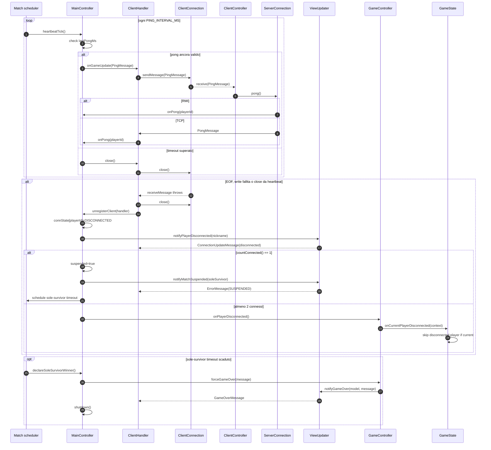

# 05 - Heartbeat e disconnessione

Il server rileva drop silenziosi con ping/pong applicativi. Tutti i canali di
disconnessione convergono su `ClientHandler.finally -> unregisterClient`.

## Canali di rilevazione

| Canale | Effetto |
|---|---|
| EOF in read | il peer ha chiuso ordinatamente |
| `IOException` in write | il server non riesce piu' a scrivere al peer |
| timeout heartbeat | nessun `PongMessage` entro `PING_TIMEOUT_MS` |
