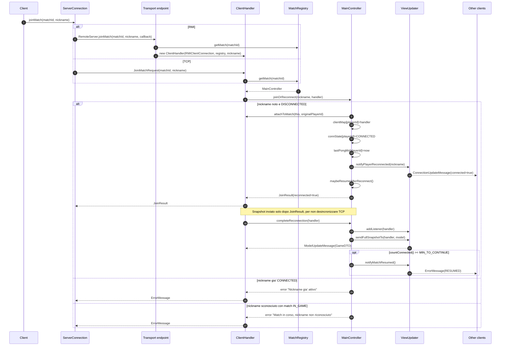

# 06 - Riconnessione

La riconnessione usa la stessa API del join: `joinMatch(matchId, nickname)`.
Se il nickname e' gia' noto nella partita e non e' attualmente connesso, il
client rientra con lo stesso `playerId`.

## Regole

- Il client deve conoscere `matchId` e nickname.
- Il `playerId` originale viene ripristinato dal server.
- Una doppia connessione viva con lo stesso nickname viene rifiutata.
- Lo snapshot completo al client rientrante e' un `ModelUpdateMessage`.
