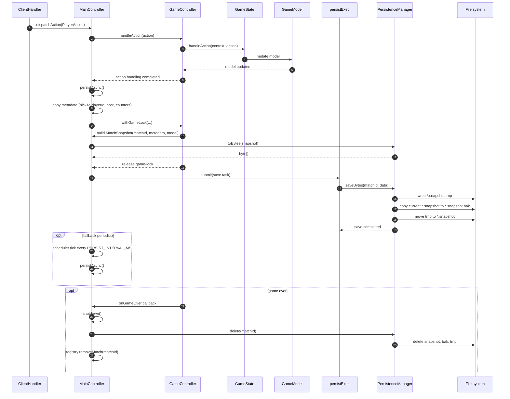

# 07 - Persistenza snapshot

La persistenza salva uno snapshot dopo ogni azione applicata e anche
periodicamente. La serializzazione avviene sotto game-lock; la scrittura su disco
avviene fuori lock, su executor dedicato.

## Garanzie

- Lo snapshot e' una root unica: `MatchSnapshot`.
- Nessuna connessione, socket, thread o `ClientHandler` viene serializzato.
- Il file finale non viene scritto direttamente: temp file, backup e rename.
