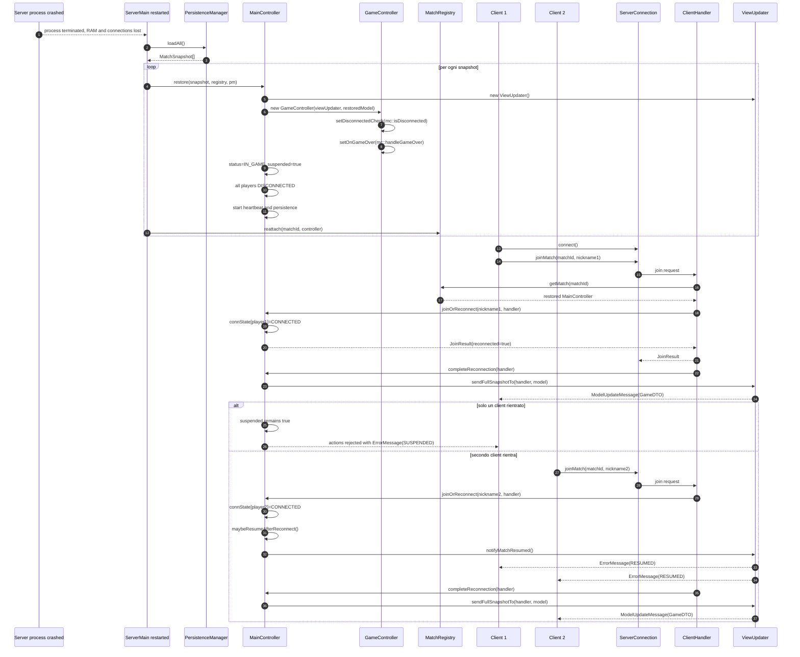

# 08 - Restore post-crash

Dopo un crash del server, le connessioni sono perse ma gli snapshot restano su
disco. Al riavvio il server ricostruisce le partite come `IN_GAME` e sospese; i
client rientrano con `matchId` e nickname.

## Nota operativa

`listOpenMatches()` mostra solo le lobby. Per rientrare in una partita gia'
iniziata dopo restore, il client deve conoscere il `matchId` della partita e il
proprio nickname.
